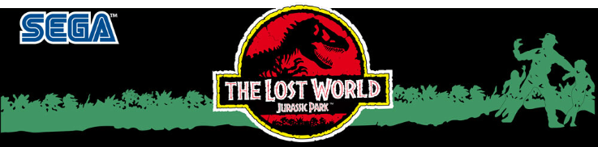
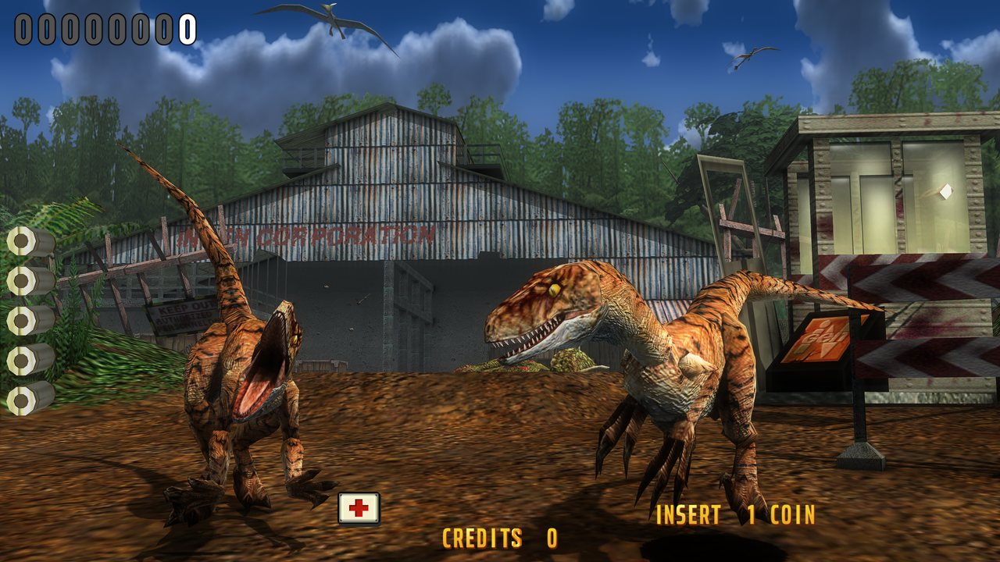
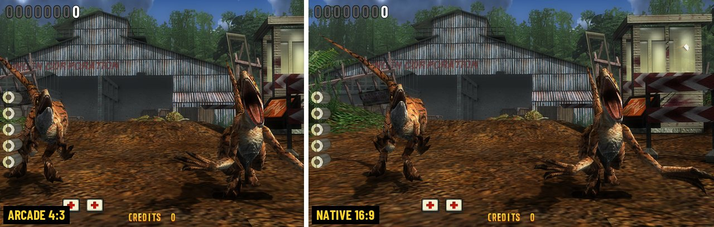
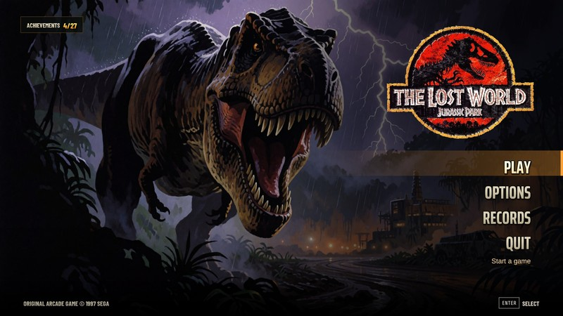
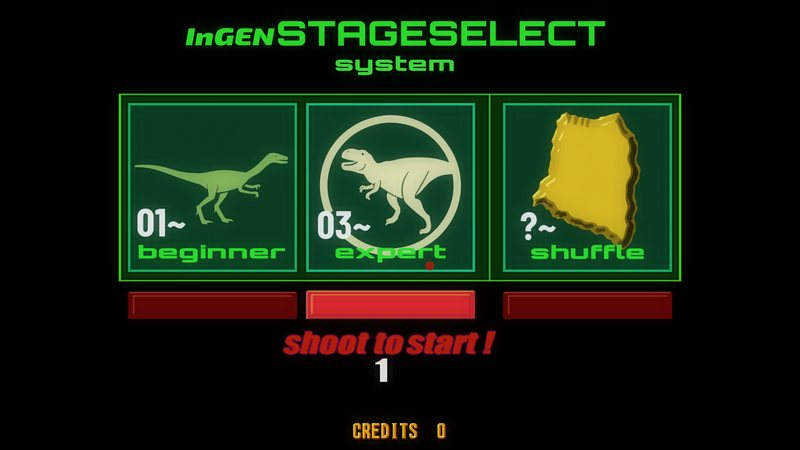

<p align="center">
  
</p>

<p align="center">
  <b>Sega's 1997 arcade light-gun game, running natively on PC.</b><br>
  Not an emulator: the original code, recompiled to C++, with a modern Vulkan renderer.
</p>

<p align="center">
  
</p>

## What you get

- **True widescreen** (16:9 or 21:9, in Options > Display > Widescreen), not stretched. Any resolution.
- **Ray-traced sun shadows**, ambient occlusion, distance haze, bloom.
- **New weather**: dense rain, wet ground, lightning in the T-Rex storm.
- **Modern flashlight** in the night stages.
- **Sharp image**: MSAA or NVIDIA DLAA, HD text and HUD, texture packs.
- **Smooth motion** at 120 / 144 Hz and above.
- **Arcade sound**, with surround and headphone modes.
- **Light guns, mouse or two mice** for 2 players; gamepads (gyro too) with `--gamepads`.
- **New modes**: Random Spawns (the arcade game shuffled), Boss Fight, Survival, achievements and stats.
- **NEW:** Ultra-widescreen support.

<p align="center">
  
</p>

<table>
  <tr>
    <td></td>
    <td></td>
  </tr>
</table>

## Light gun edition (this fork)

**Lost World Native LG** adds light gun cabinet features on top of the original port:

- **Free play** on by default, and **the trigger starts and continues** each player's game.
- **Fixed guns per player**: put `LightgunHID.ini` (made by `1 - Light Gun Setup.exe`) next to
  `LostWorld.exe` and each gun always belongs to its player.
- **Fullscreen** by default (F11 or Alt+Enter still toggles it).
- **Quick setting files** (close the game first; they take effect on the next start):
  `Graphics - Low.bat`, `Graphics - Medium.bat`, `Graphics - High.bat`, `Graphics - Ultra.bat`,
  `Crosshairs - On.bat`, `Crosshairs - Off.bat`.
- **Widescreen aim** (from the original project): in 16:9 or 21:9 the guns aim and shoot over the
  whole picture, side areas too; pointing away from the screen still reloads. In 4:3 (with the
  bezel) the crosshair stops at the picture's edge, and a shot there reloads as on the cabinet.
- **Gun-friendly menus**: the menu pointer is player 1's crosshair, and player 2's gun is ignored
  in the menus so the two guns never fight over the pointer.
- **4:3 with bezel or 16:9**: `Display - 4x3.bat` and `Display - 16x9.bat` set Settings >
  WIDESCREEN and copy the `display.ini` from the `4x3` or `16x9` folder into the game folder
  (the bezel shows only with the 4:3 picture). The bezel is read straight from `4x3`:
  your own `4x3\bezel.png` if you add one, otherwise `bezel-default.png` (which comes with it);
  updates only replace the default, never your `bezel.png`.
- **LaunchBox ready**: `Launch Lost World.ahk` (AutoHotkey 1.1) starts the game; Esc closes it
  completely and Hook of the Reaper is closed (never started) when the game ends. In the game,
  **Tab** opens and closes the pause menu (as in MAME). No console window opens behind the game.
- **START by trigger**: during play the trigger also presses that player's START (an event asks a
  player to keep pressing START: they just keep shooting). With free play the coin keys do nothing.
- **Easy install and updates**: `setup-and-build.bat` installs what the build needs and builds;
  `update.bat` downloads this fork's latest version and rebuilds (no Git needed).
- **Hook of the Reaper outputs** (TCP port 8000, like MAME): recoil once per bullet fired, ammo,
  lives, damage (not on the hit that ends a life) and death, the gun in hand and the start lamps.
  Copy `Hook Of The Reaper\defaultLG\jplostworldsa.txt` into Hook of the Reaper's defaultLG folder. The special guns from the
  pickups give a longer single kick (guns using Recoil_Value) and a shake when picked up.

Updates from the original project are checked daily and merged here only after testing.

## ⚠️ ROM not included

You need your own copy of the arcade ROM. Nothing from it is in this repository.

Look for **`lostwsga.zip`**, the *Japan, Rev. A* set (Sega Model 3 Step 1.5).
Inside you should find files like `epr-19936.20` and `mpr-19918.1`. Other
versions of the game will not work.

## Install

You need Windows 10/11 (64-bit), a Vulkan GPU, [Python 3](https://www.python.org/downloads/)
and [Build Tools for Visual Studio 2022](https://visualstudio.microsoft.com/downloads/#build-tools-for-visual-studio-2022)
with the *Desktop development with C++* workload.

<details>
<summary>Smaller install of the Build Tools (only what the build uses)</summary>

The full workload is over 6 GB. The build only needs the MSVC compiler, CMake and a
Windows SDK. In a command prompt:

```
winget install Microsoft.VisualStudio.2022.BuildTools --override "--passive --wait --add Microsoft.VisualStudio.Component.VC.Tools.x86.x64 --add Microsoft.VisualStudio.Component.VC.CMake.Project --add Microsoft.VisualStudio.Component.Windows11SDK.22621"
```

Or in the Visual Studio Installer, choose *Individual components* instead of the workload and
tick *MSVC v143 - VS 2022 C++ x64/x86 build tools (Latest)*, *C++ CMake tools for Windows*
and one *Windows 11 SDK* (it works on Windows 10 too).
</details>

1. Download or clone this repository.
2. Put `lostwsga.zip` next to `build.bat`.
3. Run `build.bat` once. It takes a few minutes and downloads SDL3 and NVIDIA DLSS on the first run.
4. Play with `LostWorld.exe`.

## Controls

| | Mouse | Gamepad |
|---|---|---|
| Aim | Move | Sticks or gyro |
| Fire | Left click | R2 / R1 |
| Reload | Right click | L2 / L1 |
| Coin + start | 5, then 1 | START |
| Pause | Esc | BACK |

F11 or Alt+Enter toggles fullscreen. Everything else is in **Options**.

Light guns that Windows sees as a mouse (Sinden, Gun4IR and the like) work as is; for a Sinden, keep
its software running for the white border. The guns aim over the whole widescreen picture, side
bands included, and shooting off the picture reloads. **Options >
Game > Free play** lets 1 / 2 (a gun's start button) start and continue without a coin, and
**Controls > Hide idle crosshair** clears a crosshair whose gun has not been used for a few seconds.
**Controls > Gun test** shows every mouse and gun Windows sees and what each one does; fire player 1's
gun and then player 2's there to keep them as those players' guns from then on.

Want your own crosshair? Drop a `crosshair.png` (with transparency) next to `LostWorld.exe`, and
`crosshair_p2.png` for player 2 if you want a different one. It is centred on the gun, and its size
is in pixels of a 1080p screen (it scales with the window).

The menus can be dressed up with files of your own in `third_party/menu/` (not in the repository):
`background.png` (or `.jpg`) behind the menus, which then sit at the right; `music.mp3` looped in the
menus (**Options > Audio > Menu music**); `logo.png`, the title over the background (transparent
PNG); `cover.png`, a poster whose logo becomes the title otherwise; and `sega.png`, SEGA's logo for the credit at the bottom left.

## More

- [Full manual](docs/MANUAL.md): every option, the modes, texture packs, debugging.
- [How it works](docs/ARCHITECTURE.md): the PowerPC to C++ recompiler and the hardware.

## Support

If you enjoy the port and want to help with the time and tools behind it, you can buy me a coffee.
Entirely optional: it supports the work on this project, not the game, which belongs to Sega.

<a href="https://buymeacoffee.com/snicolast8u"></a>

## License

The code in this repository is under the [MIT License](LICENSE). The libraries and fonts in
`third_party/` keep their own licenses. The game itself (ROM, code and data) is not included
and stays the property of its owners: you need your own copy of `lostwsga.zip`.

<sub>A fan project for personal use, not affiliated with or endorsed by Sega.
The Lost World and Jurassic Park are trademarks of their respective owners.</sub>
